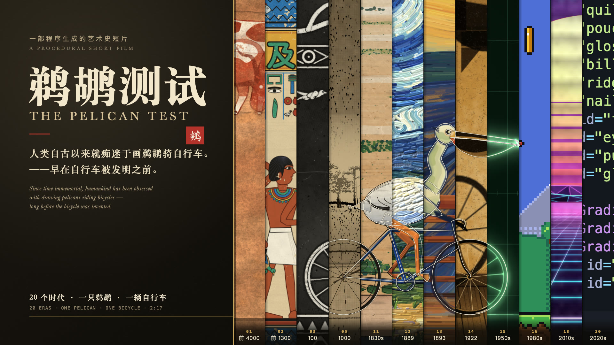
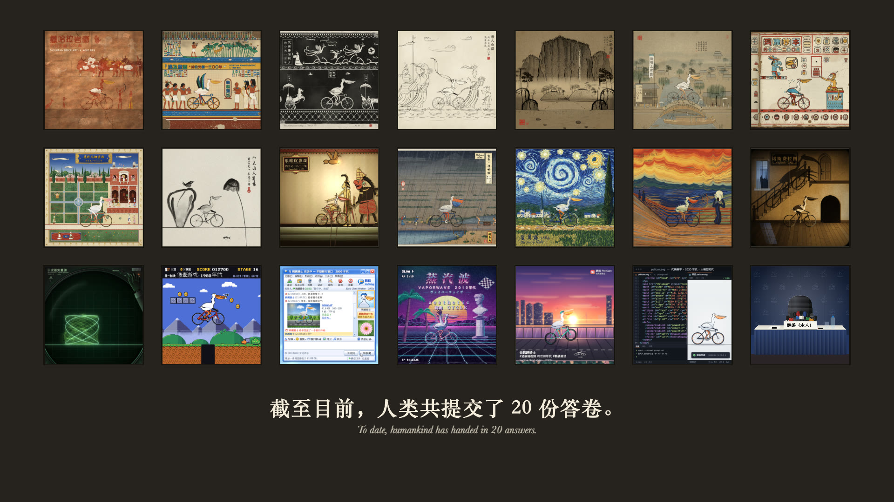
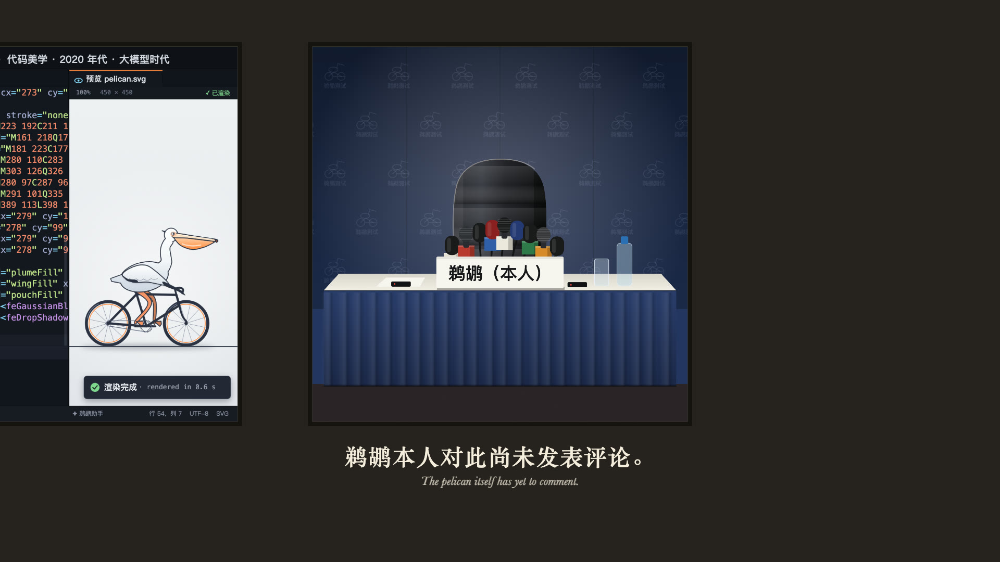

# 鹈鹕测试 · The Pelican Test

> 人类自古以来就痴迷于画鹈鹕骑自行车。——早在自行车被发明之前。
>
> *Since time immemorial, humankind has been obsessed with drawing pelicans riding bicycles — long before the bicycle was invented.*



一部 2 分 17 秒的短片。一只白鹈鹕骑着一辆现代自行车，沿着一条连续的路，穿过二十幅不同时代的画。
每过一道画框，世界就换一种画法，鹈鹕自己也跟着变成那个时代的样子。

**片中没有一张手绘图，也没有一秒录音。** 每一帧画面都由代码当场画出，每一个音符都由代码当场合成。

[English below ↓](#english)

---

## 二十个时代，二十份答卷

| # | 画风 | 年代 | 这一格里发生了什么 |
|---|---|---|---|
| 1 | 撒哈拉岩画 | 约公元前 4000 年 | 牧人和牛群停下脚步，围观这位骑车的来客 |
| 2 | 埃及壁画 | 约公元前 1300 年 | 一幅还没画完的墓室壁画：鹈鹕停下来，摆出标准的埃及侧身姿势 |
| 3 | 汉画像石拓片 | 约公元 100 年 | 混进了官员的车马出行队伍，石匠当场在空白榜题上刻下「鹈鹕骑者」 |
| 4 | 唐代白描 | 约 750 年 | 吴带当风——一阵风吹来，羽毛和衣带一起翻飞 |
| 5 | 宋代山水 | 约 1000 年 | 镜头推进千仞高山，才在山路上找到小小的骑车鹈鹕 |
| 6 | 清明上河图 | 约 1100 年 | 骑上虹桥，桥上的路人纷纷回头 |
| 7 | 玛雅抄本 | 约 1200 年 | 旁边有人用玛雅点横数字，记下它踩了多少圈 |
| 8 | 莫卧儿细密画 | 约 1600 年 | 宫廷花园里，宾客从好几个视角同时围观 |
| 9 | 八大山人 | 约 1690 年 | 寥寥几笔，大片留白，鹈鹕翻了一个八大式的白眼 |
| 10 | 爪哇皮影戏 | 约 1800 年 | 变成一只镂空皮影，车轮一顿一顿地转 |
| 11 | 浮世绘 | 1830 年代 | 富士山下的田间小道，赶路的人都回过头来 |
| 12 | 星月夜 | 1889 年 | 夜空的漩涡跟着车轮一起转 |
| 13 | 呐喊 | 1893 年 | 呐喊者被它吓了一跳，鹈鹕吼了回去，然后是尴尬的沉默 |
| 14 | 诺斯费拉图 | 1922 年 | 墙上的影子自己爬上了楼梯，离开时"通了电" |
| 15 | 示波器矢量图 | 1950 年代 | 有人转错了旋钮，鹈鹕扭成了一团李萨如图形 |
| 16 | 8-bit 像素游戏 | 1980 年代 | 跳过坑洞，吃到金币，弹出 1UP |
| 17 | 早期聊天窗口 | 2000 年代 | 被发成一张 256 色动图，对方连发两次窗口抖动 |
| 18 | 蒸汽波 | 2010 年代 | 整个世界慢放，大理石像转过头，磁带跳了针 |
| 19 | 竖屏短视频 | 2020 年代 | 画面变成竖屏，定格、慢放、点赞爆满 |
| 20 | 代码美学 | 2020 年代 · 大模型时代 | 一行一行 SVG 代码，把它重新画了出来 |

最后，二十幅画折成一面展墙，第二十一格留给了一张空着的发布会席位。



> 截至目前，人类共提交了 20 份答卷。鹈鹕本人对此尚未发表评论。



## 它是怎么做出来的

- **画面全部由代码绘制。** 用的是 [p5.js](https://p5js.org) 和 [p5.brush](https://github.com/acamposuribe/p5.brush)，再加上浏览器自带的 Canvas。岩画的颜料颗粒、水墨的晕染、梵高的厚涂笔触、示波器的荧光、8-bit 的像素，都是一笔一笔算出来的。
- **画面是"时间的函数"。** 给出任意一个时刻，程序就能画出那一刻的样子；同一时刻无论画多少次，结果都一模一样。所以可以多台浏览器同时渲染，最后拼成 60 fps 的成片。
- **一只鹈鹕，二十种画法。** 所有时代共用同一副"骨架"（鹈鹕和自行车的动作），每个时代只负责用自己的画法把它画出来，所以鹈鹕跨过画框时，前后两半能严丝合缝地对上。
- **音乐全部由代码合成。** 没有采样，也没有录音：拨弦、编钟、管风琴、芯片音乐、FM 电钢琴，都用浏览器的 Web Audio 实时合成。每个时代用自己的乐器演奏同一段原创主旋律，每次过画框的强拍上都会响一声车铃。蒸汽波那一段，是先合成一卷 80 年代商场音乐的"磁带"，再放慢到 0.79 倍播放。
- **致敬，而非临摹。** 二十幅画都是向公有领域作品与风格的致敬，构图和笑点都是原创的；片中的聊天软件、短视频平台全部是虚构的，没有使用任何真实的标志或界面。

## 致谢

本片的制作方法参考了 **Tunai-0511** 的开源项目 **[meme67-art-history](https://github.com/Tunai-0511/meme67-art-history)**。
"共享绘图工具包 + 每幅画一个场景文件 + 按时间逐帧渲染 + 无头浏览器截帧 + 接触表自查"这套工作方式就是从那里学来的。
本片没有使用它的任何代码、画面、构图或笑点。衷心感谢作者的开源分享！

也感谢 p5.js 与 p5.brush（Alejandro Campos Uribe）的作者，以及那些早已进入公有领域、至今仍在启发我们的艺术家和作品。

## 版权

- **代码**：MIT 协议，见 [LICENSE](LICENSE)。
- **影片本身**（画面、成片视频、渲染出的音乐与音效、封面和 `media/` 里的图片）：© 2026 Royce Bella，保留所有权利。
- 第三方库与字体说明见 [THIRD_PARTY_NOTICES.md](THIRD_PARTY_NOTICES.md)。

---

## 想自己跑起来？

需要 macOS（片中用到系统自带的中文字体）、Google Chrome、Node.js 20 以上和 ffmpeg。

```bash
npm install
npm run dev        # 打开 http://127.0.0.1:5180/ ，在浏览器里实时渲染整部片子（带声音）
```

预览页底部有播放、拖动进度条、逐帧步进。有些画面很重，实时播放可能会卡；想看流畅的版本，可以先渲染一份草稿视频：

```bash
node tools/render.mjs --draft && node tools/encode.mjs --draft   # 之后在预览页选"流畅播放"
```

<details>
<summary>完整渲染与工具说明（给开发者）</summary>

| 命令 | 作用 |
|---|---|
| `node tools/shot.mjs --t 5,11` | 截取指定时刻的静帧（还有 `--solo <id> --u 1,3`、`--scene <id>`、`--seam <id>`、`--debug`） |
| `node tools/sheet.mjs --film` | 全片接触表，每秒一格（也可 `--scene <id>`、`--solo <id>`） |
| `node tools/render.mjs [--draft]` | 渲染全部帧（60 fps 共 8220 帧；6 个 Chrome 并行；支持 `--from/--to`、`--resume`） |
| `node tools/audio.mjs` | 合成配乐 → `audio/mix.wav`（`--only bell` 只渲染车铃，用于对拍） |
| `node tools/levels.mjs` | 自动平衡各时代的响度 → `audio/levels.json` |
| `node tools/encode.mjs [--draft]` | 帧 + 音频 → `out/*.mp4` |
| `node tools/cover.mjs [--aspect 4:3]` | 生成封面 → `out/pelican-test_cover.png` 或 `out/pelican-test_cover_4x3.png` |
| `node tools/check.mjs` | 检查禁用 API、骑行与接缝约定、过框节拍表，以及确定性（同一帧两次渲染逐像素一致） |

完整成片：`node tools/render.mjs && node tools/audio.mjs && node tools/encode.mjs` → `out/pelican-test_1080p60.mp4`。

```
src/beat/     时间轴（节拍、几何，唯一事实来源）· 骑行（位置、曲柄、车轮）
src/kit/      绘图工具包：笔刷封装与逐笔播种、烘焙缓存、文字、纸张材质、画框、数学
src/rig/      鹈鹕与自行车的参数化骨架 · 默认钢笔线描
src/scenes/   清单 + 每个时代一个场景文件（20 个）
src/main/     入口与逐帧渲染、合成器、镜头、序幕、尾声展墙、发布会席位、预览页
audio/        Web Audio 配乐：主旋律、各时代编曲、合成乐器、蒸汽波磁带、总线
tools/        本地服务器、截图、接触表、渲染、合成、编码、封面、检查
briefs/       每幅画的美术简报与风格总纲
```

时间轴：120 BPM，一小节 2 秒，60 fps。序幕 0–5 秒；第 *i* 幅画（1–20）从 5 + 6(i−1) 秒开始，正好落在强拍上；尾声 125–137 秒。

</details>

---

## English

**The Pelican Test** is a 2:17 short film. A white pelican rides a modern bicycle along one continuous road through twenty framed paintings from twenty eras of art — from Saharan rock art, Han stone rubbings and Song ink landscapes, through Hokusai, Van Gogh, Munch and *Nosferatu*, to an oscilloscope, an 8-bit game, an early chat window, vaporwave, a vertical short video and, finally, an LLM-era code editor that writes the pelican back into being as SVG. Each time it crosses a frame, the world changes its medium, and so does the pelican.

At the end the paintings fold into a gallery wall whose 21st cell is an empty press-conference seat. *To date, humankind has handed in 20 answers. The pelican itself has yet to comment.*

There is not a single hand-drawn image or recorded sound in it: every frame is drawn by code (p5.js, p5.brush, Canvas) as a pure function of time, and all music is synthesised with Web Audio — each era plays the same original theme on its own instruments, with a bicycle bell on every frame crossing. The panels are original homages to public-domain works and styles; all apps shown are fictional.

**Thanks** to **Tunai-0511** and the open-source project **[meme67-art-history](https://github.com/Tunai-0511/meme67-art-history)**, whose working method — a shared drawing kit, one file per panel, frame-by-frame rendering as a function of time, headless capture and contact sheets — this film learned from. No code, imagery, compositions or jokes from that project are used. Thanks also to p5.js and p5.brush (Alejandro Campos Uribe).

**License:** the code is MIT ([LICENSE](LICENSE)); the film itself (frames, video, rendered music, covers and the images in `media/`) is © 2026 Royce Bella, all rights reserved.

**Run it:** macOS, Chrome, Node 20+, ffmpeg — `npm install && npm run dev`, then open http://127.0.0.1:5180/ to watch the film render live in your browser.
